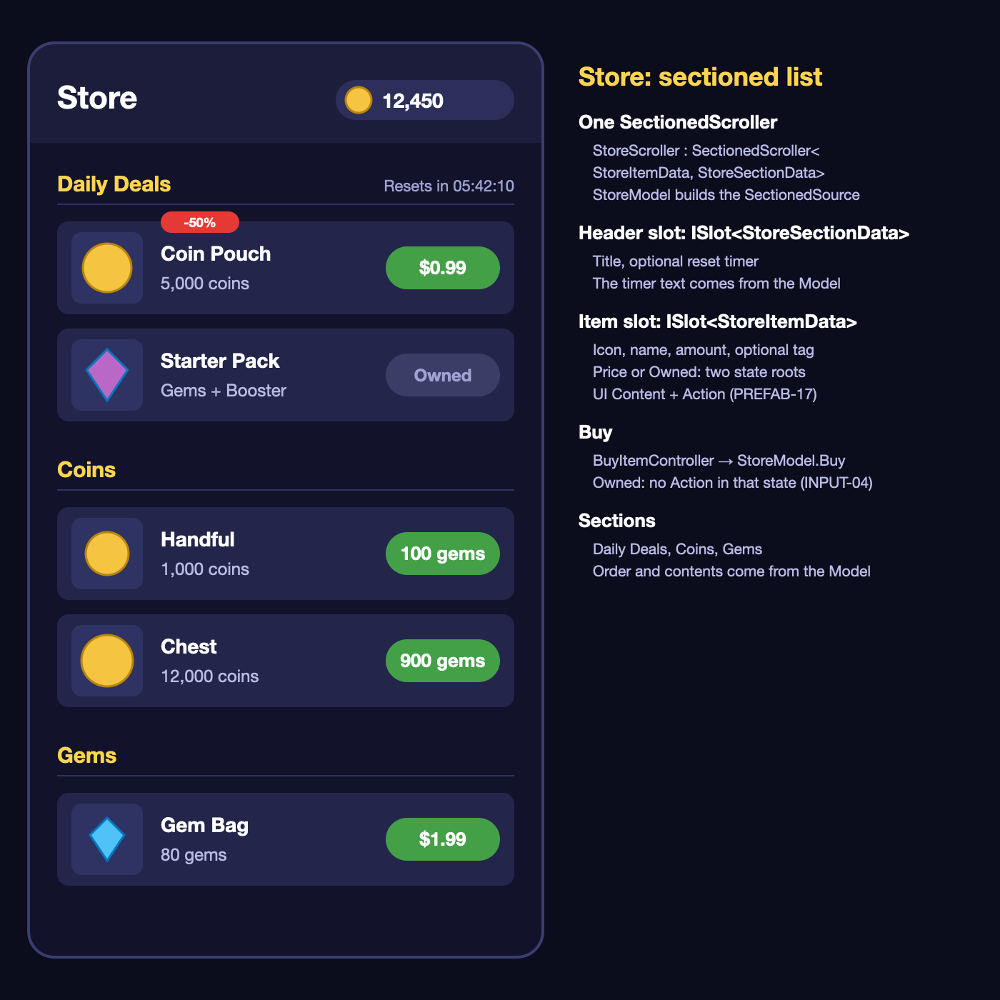
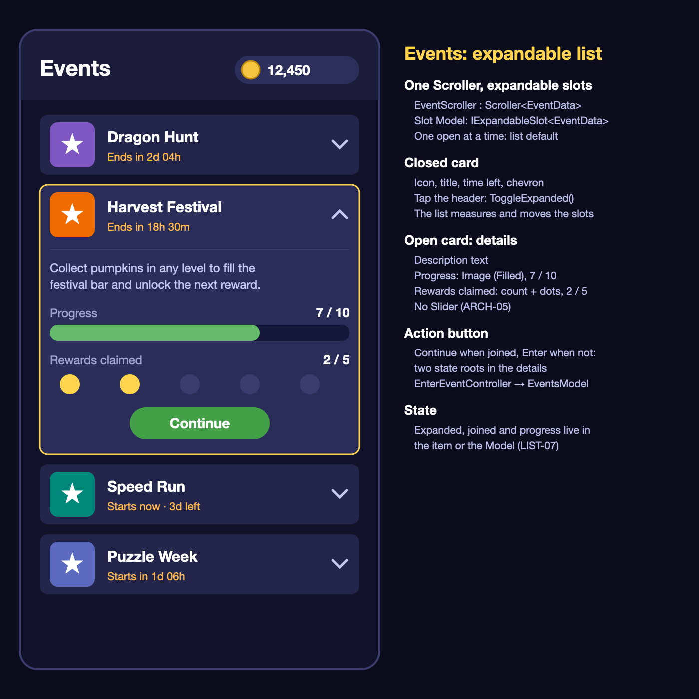

# Usage with Claude Code

This guide is for working with an AI agent, which needs the enforcement package (`.ai-enforcement`) next to the rules: see [Installation](INSTALLATION.md). Without it the rules are documents only.

How to work with Claude Code once the rules are [installed](INSTALLATION.md): prompts that work, what the agent does with each, and what the Stop hook checks before it lets the agent finish.

You don't need to name the rules in your prompts. Claude Code loads `CLAUDE.md`, which loads `.ai/AGENTS.md` and your `AGENTS.md`; the agent reads the documents the routing table selects for the task. Name a rule ID only when you want a specific one applied or explained.

## Two ways to work

| | Editor open (MCP for Unity) | Editor closed |
|---|---|---|
| Compile | The agent calls `refresh_unity` and reads the Console | `scripts/verify.sh`, in batch mode |
| Tests | `run_tests` with a filter, then `get_test_job` | `VERIFY_TEST_FILTER="..." scripts/verify.sh` |
| Prefabs | Built and checked through `execute_code` (`EDIT-11`, `EDIT-12`) | The agent writes the spec; you build it with **Assets > Unity Architecture > Build Prefab From Spec**, which validates it and compares it with the spec |
| Play mode check | Automated: enter Play mode, try the input, read the Console, exit (`EDIT-07`) | A manual step it reports for you |
| Stop hook | `scripts/verify-editor.sh` reads the results the Editor writes to `Logs/verify/` | `scripts/verify.sh` compiles, and runs the tests when they're due |
| Needs | MCP for Unity (optional) | Nothing beyond the install |

MCP for Unity is optional. Without it, work with the Editor closed: everything in the rules applies, and only the steps that need the open Editor (building a prefab, the Play mode check) become yours. If you keep the Editor open without MCP, the hook can't ask the agent to compile or test there, so it reports that it couldn't check instead of blocking; close Unity for a full check. With MCP, work with the Editor open for anything with UI.

## What happens on every task

1. The agent classifies the request ([Agent workflow](../architecture/workflow/planning.md#task-classification)). A question gets an answer, a small change gets made, and a new feature, screen or refactor gets the [scope question](../architecture/workflow/planning.md#scope-question) (code only, with prefabs, with tests) and a plan first. Say the scope in your prompt to skip the question. The plan is written to `Logs/ai/plan.md` in a fixed form, with each decision taken from a closed list, so you can compare two runs and the delivery with it (`PLAN-02`).
2. It takes the forks from the [project profile](../architecture/OPTIONAL_PACKAGES.md#the-profile), which the SessionStart hook put in its context, and opens only the branch each one names: its code uses Fast IoC, UI Scroller, Screen System or UI Foundations only when they're installed, and it never reads the rules for the ones that aren't. The same hook gives it the project facts (scenes, installers, `Client.asmdef` references, features, localization) and the index of task packs: it reads the pack of each part of the task in one call, with the forks already resolved and the package documentation it needs, instead of walking the rule files (`OPT-07`).
3. It writes what the scope includes: the code, and the prefabs and tests when you chose them, with Model tests first (`TEST-08`).
4. It compiles, reads every error and warning (`EDIT-02`), and fixes compile and (if installed) analyzer errors in the code, never by suppressing them (`EDIT-03`).
5. It runs the tests related to the change (`TEST-11`).
6. It ends with what each tool verified and what it didn't ([Reporting back](../architecture/EDITOR_TOOLS.md#reporting-back)).
7. When it stops, the hook checks again. If something fails, the hook sends the failure back, and the agent keeps working until the check passes or three attempts in a row fail.

## Rules Guide

**Tools > Unity Architecture > Rules Guide** shows the rules written for people, with search. **Settings** (the gear) switches between English and Spanish. The home page ends with the author's other tools, their git URLs, and which ones the project already has.

## Examples

Each example is a prompt you can paste, followed by what the agent should do. Replace the names with your own.

### 1. Check the setup

```text
Check that this project is set up for the .ai rules: read the project profile (Logs/ai/profile.md) and list its forks and capabilities, refresh Unity, read the Console, run the prefab validator test, and tell me what each tool verified.
```

The agent reads `Packages/manifest.json` and lists every capability, calls `refresh_unity`, reads the Console, and runs `ClientPrefabsTests` through `run_tests`. Do this once after installing, and again whenever something in the setup changes.

### 2. Plan a new feature

```text
Plan a TrophyRoom feature: a screen with a list of trophies loaded from the backend, and a details popup with a claim button. Don't write code yet.
```

A new feature is "plan first, wait for approval". You get a short plan in the [plan format](../architecture/workflow/planning.md#plan): location, new files, where each Model lives, scopes, tests, capabilities and open questions. Answer the open questions, then:

```text
Approved. Build it.
```

The closest example is [Backend feature](../architecture/examples/01_BACKEND_FEATURE_TROPHY_ROOM.md).

### 3. Build a UI prefab with the Editor open

```text
Build a ClaimTrophyBanner for a new Rewards feature in Assets/Client/Rewards/ClaimTrophyBanner/: a background, a title text, a trophy icon, and a tap that claims the trophy. The Model counts claims, and the banner shows "Claimed" after the first tap. Write the handoff as a JSON spec, build it with PrefabSpecs.BuildFromSpec, validate and compare it, run the related tests, and do the Play mode check.
```

What the agent does, in order:

1. It writes the Model, View and Controller in `Assets/Client/Rewards/ClaimTrophyBanner/`, and the Model tests in `Assets/Client/Rewards/Tests/`, with the feature's `Client.Rewards.Tests.asmdef` (`ASM-03`). With UI Foundations installed, the Controller derives from `BaseClickController` (`OPT-02`).
2. It compiles (`refresh_unity`) and runs the new tests.
3. It writes `ClaimTrophyBanner.json`, the handoff as a [prefab spec](../architecture/PREFABS.md#prefab-spec) (`HAND-06`): a `UI Content` with the background, title and icon, and the `Action` next to it (`PREFAB-17`).
4. It builds the prefab through `execute_code`:

   ```csharp
   // execute_code has no using directives: name the types in full.
   string json = System.IO.File.ReadAllText("Assets/Client/Rewards/ClaimTrophyBanner/ClaimTrophyBanner.json");
   string prefab = "Assets/Client/Rewards/ClaimTrophyBanner/ClaimTrophyBanner.prefab";
   var built = UnityArchitecture.Prefabs.PrefabSpecs.BuildFromSpec(json, prefab);
   var checkedAgain = UnityArchitecture.Prefabs.PrefabValidator.ValidateAsset(prefab);
   var differences = UnityArchitecture.Prefabs.PrefabSpecs.Compare(json, prefab);
   ```

5. It reports the validator result and the differences, which must both be empty (`EDIT-12`), then reads the built hierarchy back (`EDIT-05`).
6. It runs `ClientPrefabsTests`, the validator as a test (`TEST-12`).
7. It enters Play mode, puts the prefab under a Canvas, taps the `Action`, checks that the Model and the View changed, reads the Console and exits.

What the spec can't express yet (a gradient, a sprite, font size or alignment) is reported, not improvised (`EDIT-11`). Set those by hand in the prefab afterwards, or wait for the spec to support them.

### 4. Change an existing prefab

```text
In the ClaimTrophyBanner, move the icon to the right side and make the banner 900 wide. Change the spec and rebuild it.
```

The agent edits the JSON spec, rebuilds it with `BuildFromSpec`, and reports the validator and `Compare` results. A change made by hand in the prefab shows up as a difference in `Compare`, so the spec stays the source of truth. For a prefab that has no spec, it opens the prefab with `PrefabUtility.LoadPrefabContents`, changes it with `PrefabRecipes` and saves it.

### 5. Validate every prefab

```text
Run the prefab validator on every prefab under Assets/Client and fix what it reports.
```

The agent runs `ClientPrefabsTests` (or **Tools > Unity Architecture > Validate Client Prefabs**). Each error names the prefab, the object and the rule (for example `PREFAB-09` for an `Action` that isn't invisible). It fixes the prefab by rebuilding it from its spec or changing it with the recipes, never by changing the validator or writing the prefab as text (`EDIT-06`).

### 6. Add a list

A list prompt works best when it says four things: the data each row shows, where that data comes from, what a tap does, and how it should look. An image of the screen settles the look: Claude Code reads a PNG path in the prompt, so attach a mockup or a screenshot from your designer. The two mockups below are in `.ai/docs/images/`. Each one is a phone screen, with notes on how the rules build it.

#### A list with sections: a store



```text
Create a Store list in Assets/Client/Store/StoreMain/ that looks like .ai/docs/images/store-list.png.
It has three sections, each with a header: Daily Deals (with a reset timer), Coins and Gems. Each item shows an icon, a name, an amount, an optional discount tag, and its price, or "Owned" once bought. StoreModel owns the catalog and the coin balance, and decides which items are owned. Tapping the price buys the item through StoreModel.Buy, which can fail if the player can't afford it. Owned items can't be tapped. Use made-up catalog data in StoreModel for now, with tests for Buy.
```

What the agent does:

1. Plans first (a new feature), with `uiScroller` checked: a `SectionedScroller<StoreItemData, StoreSectionData>` that `StoreModel` feeds with a `SectionedSource`. Without UI Scroller, it plans the [plain Unity list](../architecture/branches/no-ui-scroller/lists.md) instead and says that it has no headers (`OPT-01`).
2. Writes `StoreModel` with its tests first (`TEST-08`): the sections, `Buy`, what happens when the player can't afford an item, and an event when something changes.
3. Writes two slots, each with a Slot Model that implements `ISlot<T>`: a header slot (title and timer) and an item slot. The item slot has Price and Owned state roots, and only the Price state has an `Action` (`INPUT-04`). Its `UI Content` wraps the visuals (`PREFAB-17`), and `BuyItemController` derives from `BaseClickController` when UI Foundations is installed.
4. Builds both slot prefabs and the screen from specs, validates them, and runs the tests.
5. Reports what the spec couldn't set, such as the icons' sprites and the fonts.

#### A list with expandable items: events



```text
Create an Events list in Assets/Client/Events/EventsMain/ that looks like .ai/docs/images/event-list.png.
Each card shows the event's icon, title and time left. Tapping a card opens it to show the details: a description, a progress bar with "7 / 10", how many rewards were claimed out of the total, with one dot per reward, and a button. The button says Continue if the player has joined the event and Enter if they haven't; Enter joins the event through EventsModel, and Continue opens the event (log it for now). Only one card is open at a time. EventsModel owns the events and the player's progress, with tests.
```

What the agent does:

1. Plans first: a `Scroller<EventData>` whose slot is expandable. The Slot Model implements `IExpandableSlot<EventData>`, and tapping the card's header calls `ToggleExpanded()`, so the list measures the open card and moves the cards below it ([Expandable slots](../architecture/branches/ui-scroller/lists-layouts.md#expandable-slots)). One card at a time is the list's default (**Allow Multiple Expanded** off): opening a card closes the open one by itself.
2. Writes `EventsModel` and its tests first: joining, progress, rewards claimed. Whether a card is open and whether the player joined live in the Model, never in the slot, which shows another event later (`LIST-07`).
3. Builds the progress bar as an `Image` set to Filled, not a `Slider` (`ARCH-05`), and the button with Enter and Continue state roots, each with its own `Action` and Controller.
4. Gives the slot a layout group so the list can measure it open (`DefaultExtent` is the closed height), and keeps `UI Content` around what each `Action` hits (`PREFAB-17`).
5. Validates the prefabs, runs the tests, and in Play mode opens a card, checks that the one below moves, and taps Enter.

#### A filtered list with a details panel

```text
Add an inventory list to Assets/Client/Inventory/MainInventory/ with tabs for Weapons and Armor, a selected item, and a details panel.
```

With `uiScroller` the agent uses a `Scroller<T>`, with a Slot Model on the slot prefab. Without it, it uses the [plain Unity list](../architecture/branches/no-ui-scroller/lists.md). The closest example is [Filtered list](../architecture/examples/03_FILTERED_LIST_INVENTORY.md).

**Assets > UI Scroller > New Scroll List** is for people: it writes the same Model, View and Controller split the agent writes (`LIST-09`). The agent doesn't run it through MCP, since it opens a window (`EDIT-13`), so don't ask for it in a prompt.

### 7. Replace a Toggle or a Slider

```text
Add a settings panel with a music toggle and a volume slider, without Toggle or Slider components.
```

`ARCH-05` forbids `Selectable` components, so the agent builds a View with On and Off roots plus a click Controller, and an `Image` fill plus a drag Controller. See [Custom input](../architecture/examples/02_CUSTOM_INPUT_SETTINGS.md).

### 8. Review code against the rules

```text
Review Assets/Client/Shop for rule violations. Cite the rule ID for each one, and don't change anything.
```

A review is answered directly. Each finding names the file, the line and the rule (`ARCH-04`, `VIEW-07`, `CTRL-03`...). Ask for fixes afterwards, one finding or all of them.

### 9. Fix a bug

```text
The coin balance doesn't update after a purchase. Find the cause and fix it, with a test that fails without the fix.
```

`TEST-04`: the fix comes with a test that fails without it. The agent runs that test and the tests of the classes it changed.

### 10. Work with the Editor closed

Close Unity, then:

```text
Add a ClaimTrophy command to TrophyRoomModule that rejects a trophy already claimed, with tests.
```

The agent verifies with `VERIFY_TEST_FILTER="TrophyRoomModuleTests" scripts/verify.sh`, and the hook compiles with `verify.sh` when it stops. If the change needs a prefab, it writes the spec for you to build with **Build Prefab From Spec** (or the handoff table, without the rules' package), and reports the Play mode check as a manual step.

### 11. Explain a rule

```text
Why can't a View call a Model command? Explain VIEW-02 with an example from this project.
```

### 12. Update the rules

Ask Claude Code, or run it yourself:

```bash
bash .ai/templates/scripts/update.sh
```

On Windows, outside Git Bash: `.ai\templates\scripts\update.cmd`.

It updates `.ai`, refreshes the copied files you didn't change, and lists the ones you did. Then:

```text
The .ai rules were updated. Read .ai/CHANGELOG.md and tell me what changed that affects this project's code.
```

## The Stop hook's messages

| Message | What the agent does |
|---|---|
| `scripts/check-feature.sh failed`, with `CHK-..` lines | Fixes each line (a name, a namespace, a file not in the plan, a missing installer, spec, test assembly or handoff section), then stops again |
| "Unity hasn't compiled the latest script changes" | Calls `refresh_unity`, reads the Console and stops again |
| "Prefabs of Rewards changed after the prefab validator last checked them" | Runs that feature's `ClientPrefabsTests` case with `run_tests` and stops again |
| "The tests of Rewards are due" | Runs that feature's tests with `run_tests` (`group_names`) and stops again. This happens on every stop while the task is scoped to the feature |
| A prefab error with a rule ID | Rebuilds or fixes the prefab, and runs the validator again |
| A compile or analyzer error (`CS...`, `UA00..`) | Fixes the code |
| "Verify passed" | Nothing: the agent can finish |

To scope a task's tests without being asked (`TEST-13`), name the folder in the prompt: `tests: Assets/Client/Rewards`. Without it, the agent asks with the scope question; leave it empty for the whole project.

The hook gives up after three failed attempts in a row and says so. Then read the failure yourself, or ask the agent to continue.

## Timing

While you tune the pipeline, every prompt ends with one line on screen from the timing hook, short so the app doesn't cut it:

```
Timing: 4m 05s · first file 1m 50s after 7 calls (6 rule docs) · outside packs 1 · claude-opus-5-5 (14 calls) · tokens 1.1M / 18k · ~$1.23 · details: scripts/timing-report.sh --last
```

`scripts/timing-report.sh --last` prints the whole summary of that prompt:

```
Turn summary
  Model                  claude-opus-5-5 (14 calls)
  API calls              14
  Tokens in / out        1.1M / 18k (cache read 1.1M)
  Cost (list prices)     $1.23 (claude-opus-5-5 $1.23)
  Total                  4m 05s
  To the first file      1m 50s
  Calls before writing   7
  Rule docs read         6
  Outside packs          1 calls (pkg:unity-architecture/unity/Editor/AssetSpecs.cs)
Stages
     3s  Read pack new-feature
     4s  Read package source
    46s  Write other code
    24s  Compile and check
```

The model, API calls and tokens come from the session's transcript, subagents included, so a run with a subagent on a smaller model lists both. The cost is an estimate at the API list prices in `.ai/model-prices.json` (input, output, cache reads, and cache writes at 1.25x or 2x, Haiku's long-context rate above 100K input tokens); a model missing there shows as unpriced. On a subscription you aren't billed per token, but it still compares runs and models. Update the file when prices change. A stage's seconds include the time the model spent deciding on each step, not only the tool's run. **Outside packs** lists the rule files and package files read after a pack (`OPT-07`). `scripts/timing-report.sh` prints every step of the latest session, and `scripts/timing-report.sh --last` the last prompt again. The logs are in `Logs/agent-timing/`, one TSV per session, without prompt text, tool arguments or file contents. Set `AGENT_TIMING_SUMMARY=0` in `.claude/settings.json` `"env"` to hide the summary and keep logging.

## Tips

- **Say where.** A path such as `Assets/Client/Rewards/ClaimTrophyBanner/` settles the feature, the folder and the namespace (`Client.Rewards`).
- **Say what the Model owns.** "The Model counts claims" tells the agent where the state lives and what to test.
- **Attach the look.** A PNG path in the prompt, such as `.ai/docs/images/event-list.png` or your designer's screenshot, settles colors, order and spacing that words leave open.
- **Ask for a spec when you'll iterate on a prefab.** Changing a JSON file and rebuilding is repeatable; changing a prefab by hand isn't.
- **Keep project-only rules in your `AGENTS.md`**, such as "scene transitions go through `BaseStartScene.LoadSceneAsync`". The agent reads them on every task.
- **Read the last lines of each report.** "Verified" lists what a tool checked; "Not verified" lists what you still have to check.
